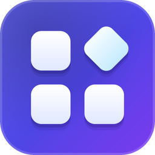
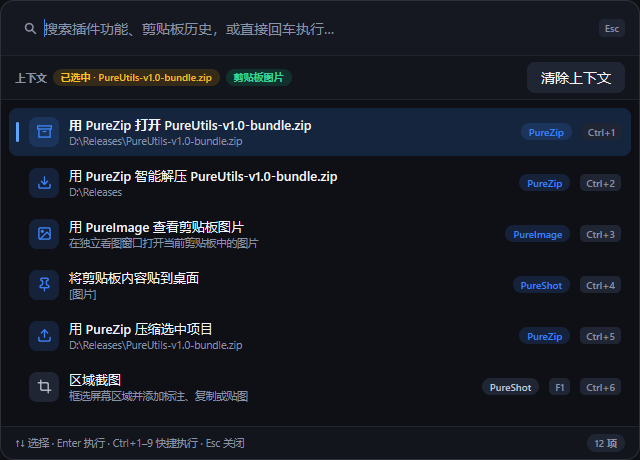
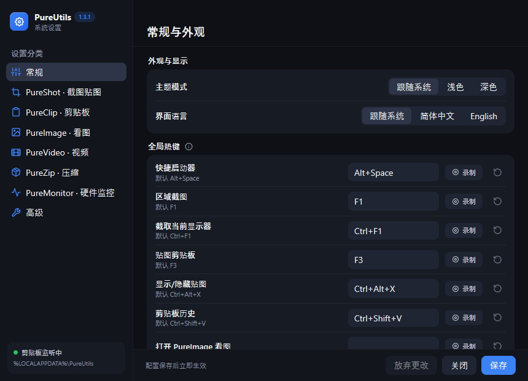
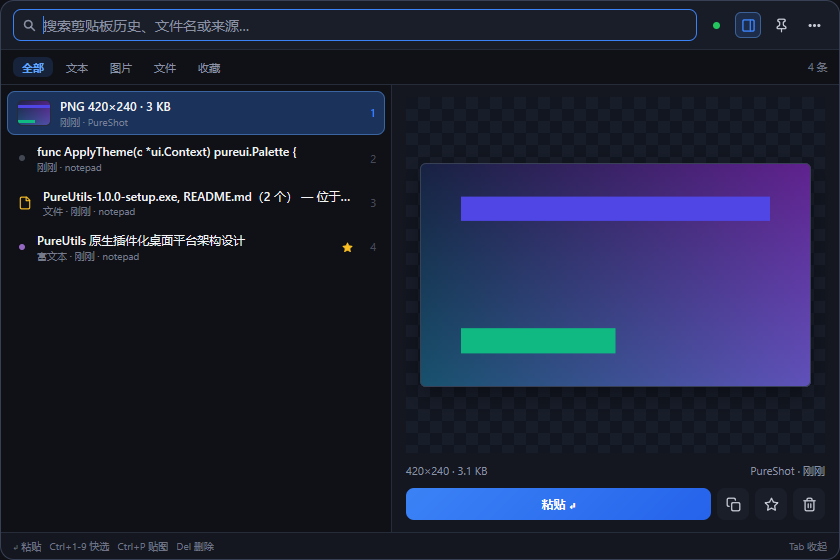
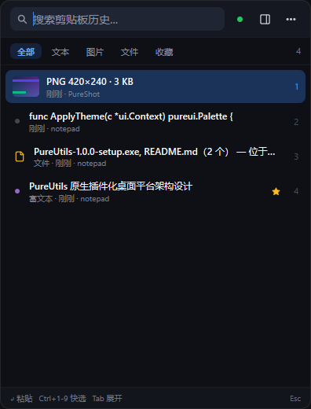
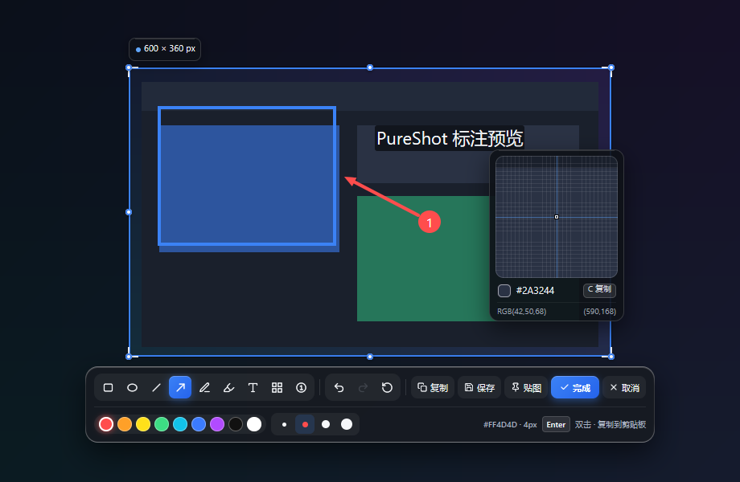
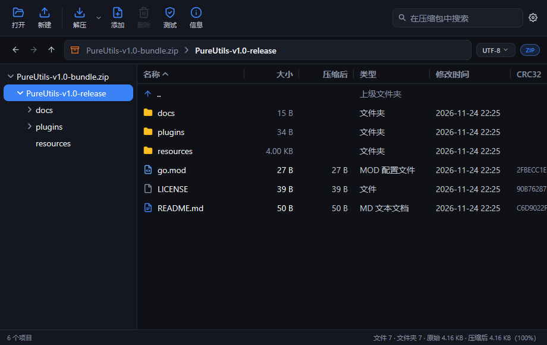
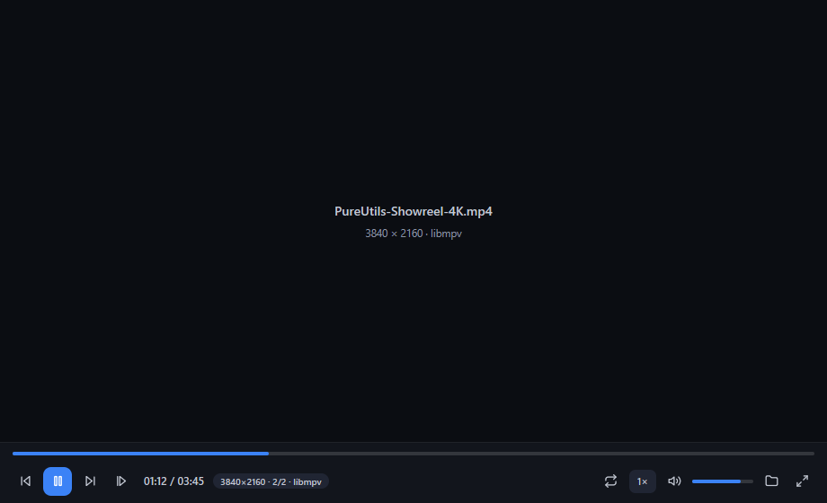

<div align="center">



# PureUtils

**Modular Native GPU-Rendered Desktop Utility Suite for Windows**  
Screenshot & Pinning · Clipboard History · Fast Image & Video Browser · Archive Manager · Global Launcher

[](LICENSE)
[](go.mod)
[](installer/pureutils.iss)
[](docs/ARCHITECTURE.en.md)
[](https://wangsyi.github.io/PureUtils/?lang=en)

[简体中文](README.md) | **English** | [Website](https://wangsyi.github.io/PureUtils/?lang=en) | [Architecture](docs/ARCHITECTURE.en.md) | [Releases](https://github.com/WangsYi/PureUtils/releases)

</div>

---

**PureUtils** consolidates everyday Windows productivity tools into a single lightweight executable with **zero WebView, zero JavaScript, and zero cgo**. Powered by **Go 1.27 + [MyGo](https://github.com/egoist/mygo) native GPU UI** and the reusable **`pkg/purekit`** plugin framework, every module can be trimmed at **compile time**, toggled during **installation**, or switched live at **runtime**.

---

## Key Features

### Six Decoupled Built-in Plugins (Zero Cross-Plugin Imports)

| Plugin | Module ID | Capabilities |
|---|---|---|
| **PureShot** | `capture` | Frozen region capture, smart window snapping, pixel magnifier (`C` silent hex copy), 9 vector annotation tools, double-click quick finish, always-on-top desktop pins |
| **PureClip** | `history` | Isolated SQLite (WAL) & SHA-1 content-addressed image blobs, instant in-memory multi-token search (`<1ms`), async thumbnail/preview decoding cache, filters/favorites, sensitive process exclusion, read-only legacy DB fallback |
| **PureImage** | `viewer` | **40+ formats** (JPG, PNG, GIF, WebP, HEIC, AVIF, JPEG XL, 24 camera RAW formats & animations), native `libjpeg-turbo` DCT scaling, EXIF inspector, Windows Explorer **Spacebar quick preview** & `P` desktop pin |
| **PureVideo** | `video` | Bundled Tier 1 trimmed **`libmpv` hardware decoding engine**, supporting 21 video formats (MP4, MKV, MOV, HEVC, FLV, WebM, etc.), external subtitles, frame-step, speed/loop controls, and HKCU file associations |
| **PureZip** | `zip` | Pure-Go archive manager (read/write `ZIP, 7Z, TAR, TAR.GZ, TAR.BZ2, TAR.XZ, TAR.ZST`; read `RAR v4/v5` & single-file `GZ/BZ2/XZ/ZST`), folder tree, smart extract, AES-256 / `-mhe`, codepage switcher, Explorer cascading context menu & file associations |
| **PureMonitor** | `monitor` | Taskbar strip & edge-docked collapsible floating pill (selectable metrics), full hardware & sensor dashboard (optional PawnIO/elevated helper, AMD ADL & NVML), and zero-injection ETW game FPS overlay |

### Platform Capabilities

- **Global Context-Aware Launcher (`Alt+Space`)**: Instantly captures selected Windows Explorer items and clipboard contents to surface relevant actions (*Smart Extract*, *Open in PureImage*, *Pin to Desktop*) alongside full plugin & clipboard history search (`Ctrl+1–9` quick run).
- **Live Component Hot-Toggle & Low-Level `Win+` Hotkey Takeover**: Enable/disable built-in modules cleanly in Settings without restarting—dynamically rebuilding tray items, hotkeys, launcher matchers, and Capability Bus registrations. Optional `WH_KEYBOARD_LL` takeover suppresses the Windows Start menu when rebinding `Win+...` chords.
- **Full Bilingual i18n (`zh-CN` / `en-US`)**: Supports Simplified Chinese, English, and automatic OS language detection (`Auto`) across tray menus, Launcher, Settings, and all six plugins—applying live without restart.
- **Zero-Coupling Capability Bus (`pkg/purekit`)**: Plugins interact solely via strongly typed bus contracts (`clipboard.history`, `image.preview`, `image.pin`) and source-aware clipboard events, degrading gracefully whenever a sibling module is disabled or omitted.

---

## Screenshots

### Global Launcher (`Alt+Space`) & Unified Settings
| Context-Aware Launcher | Settings & Live Component Toggles |
| :---: | :---: |
|  |  |

### Clipboard History (PureClip: Split View & Compact Popup)
| Split Inspector View | Compact Quick-Select Popup |
| :---: | :---: |
|  |  |

### Screenshot & Annotation (PureShot), Archive Manager (PureZip) & Video Browser (PureVideo)
| PureShot Region & Annotations | PureZip Archive Manager | PureVideo Browser |
| :---: | :---: | :---: |
|  |  |  |

---

## Installation

- Download the modular installer `PureUtils-1.3.0-setup.exe` (with built-in trimmed `libmpv-2.dll`) from [**GitHub Releases**](https://github.com/WangsYi/PureUtils/releases).
- Installs per-user (`%LOCALAPPDATA%\Programs\PureUtils`, no UAC required) with customizable components: **Full Suite / PureShot+PureClip / PureImage only / PureVideo only / PureZip only**, optional `turbojpeg.dll`, Explorer context menus, and HKCU file associations.

---

## Building from Source

Prerequisites: Windows 10/11 (x64) + **Go 1.27.3+** (no cgo, no Node, no WebView2). Optional: Inno Setup 6/7 (`ISCC.exe`) for installer packaging.

```powershell
# Build full binary with all 6 plugins
.\build.ps1 build

# Build slim core binary without PureImage / turbojpeg.dll (-tags nofreeimage)
.\build.ps1 build -CoreOnly

# Selectively exclude specific plugins at compile time (supports pureshot, pureclip, pureimage, purevideo, purezip, puremonitor)
.\build.ps1 build -Exclude purezip,pureimage

# Run full tests, bilingual UI/layout checks, E2E, and merged coverage report
.\build.ps1 test
.\build.ps1 test -CoreOnly
.\build.ps1 ui
.\build.ps1 e2e
.\build.ps1 coverage -MinCoverage 50

# Launch directly into a specific view
.\build.ps1 run -AppArgs --launcher

# Publish portable folders or create modular Inno Setup installer
.\build.ps1 publish
.\build.ps1 pack
```

---

## Default Shortcuts & CLI Flags

| Default Shortcut | Action | CLI Flag |
|---|---|---|
| `Alt+Space` | Open Global Plugin Launcher | `--launcher` |
| `F1` | Region Capture & Annotation | `--capture` |
| `Ctrl+F1` | Capture Monitor Under Cursor | `--capture-monitor` |
| `F3` | Pin Clipboard Content to Desktop | `--pin` |
| `Ctrl+Alt+X` | Show / Hide All Desktop Pins | `--toggle-pins` |
| `Ctrl+Shift+V` | Open Clipboard History Popup | `--history` |
| Configurable | Open PureImage / Toggle Explorer Spacebar Preview | `--view [path]` / `--toggle-space-preview` |
| Configurable | Open PureVideo Fast Video Browser | `--video [path]` |
| Configurable | Open PureZip / Archive Operations | `--zip [path]` / `--extract-smart <file>` |
| Configurable | Open PureMonitor Hardware Dashboard | `--monitor` |

Additional CLI flags: `--settings`, `--toggle-monitoring`, `--extract-here`, `--extract-to`, `--extract-dialog`, `--compress`, `--compress-zip`, `--compress-7z`, `--test-archive`, `--background`, `--perf`, `--exit`, or pass an image/archive/folder path directly.

---

## Data Directory & Read-Only Legacy Support

User data is stored under `%LOCALAPPDATA%\PureUtils` (override with `PUREUTILS_HOME`):

```text
settings.json                  v2 settings (host config + plugins.<id> namespaces)
plugins\pureclip\clip.db       PureClip isolated clipboard database (SQLite WAL)
plugins\pureclip\blobs\...     PureClip SHA-1 content-addressed images
plugins\pureshot\shots.db      PureShot capture metadata database
plugins\pureshot\blobs\...     PureShot saved capture blobs
logs\                          Daily rotating logs
```

> Legacy `settings.json` (v1), `pureutils.db`, `shotclip.db`, and `images\` are surfaced in strict **read-only** fallback mode without mutating existing user files on startup.

---

## Repository Layout

```text
main.go                       MyGo single-instance entry point, modules.json loader & host wiring
pkg/purekit/                  Reusable plugin SDK (Plugin/Host/Bus/Contracts, config, storage, clipboard, platform, ui, core)
plugins/
  ├─ pureshot/                Region capture, vector annotation baker (annotate/), and floating pins
  ├─ pureclip/                Clipboard watcher, SQLite/blob storage, and fast search history UI
  ├─ pureimage/               40+ image/RAW codecs, EXIF, TurboJPEG, Spacebar preview & HKCU associations
  ├─ purevideo/               Bundled libmpv hardware playback, controls & HKCU associations
  ├─ purezip/                 Pure-Go archive engine (archive/), Explorer shell integration (zipshell/)
  └─ puremonitor/             Taskbar & floating overlays, hardware sensors & ETW game FPS HUD
internal/host/                Thin host shell (conditional builtin_*.go bridges, tray, hotkeys, launcher, settings, AST tests)
installer/pureutils.iss       Inno Setup modular installer script
docs/                         GitHub Pages showcase website, bilingual architecture docs & screenshots
```

See [**docs/ARCHITECTURE.en.md**](docs/ARCHITECTURE.en.md) ([中文版](docs/ARCHITECTURE.md)) for architecture details, Capability Bus contracts, and plugin authoring instructions.

---

## Maintenance Policy & License

- **PureUtils** is maintained personally by the author and **does not accept external Pull Requests or code contributions** (see [CONTRIBUTING.md](CONTRIBUTING.md)). You are still welcome to file bug reports via GitHub Issues; please review [SECURITY.md](SECURITY.md) for vulnerability reports.
- See [CODE_OF_CONDUCT.md](CODE_OF_CONDUCT.md) and third-party notices in [THIRD_PARTY_NOTICES.md](THIRD_PARTY_NOTICES.md).
- Licensed under the [**GNU Affero General Public License v3.0 (AGPL-3.0)**](LICENSE).
