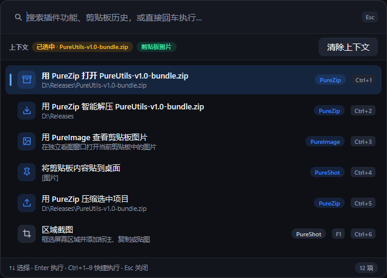
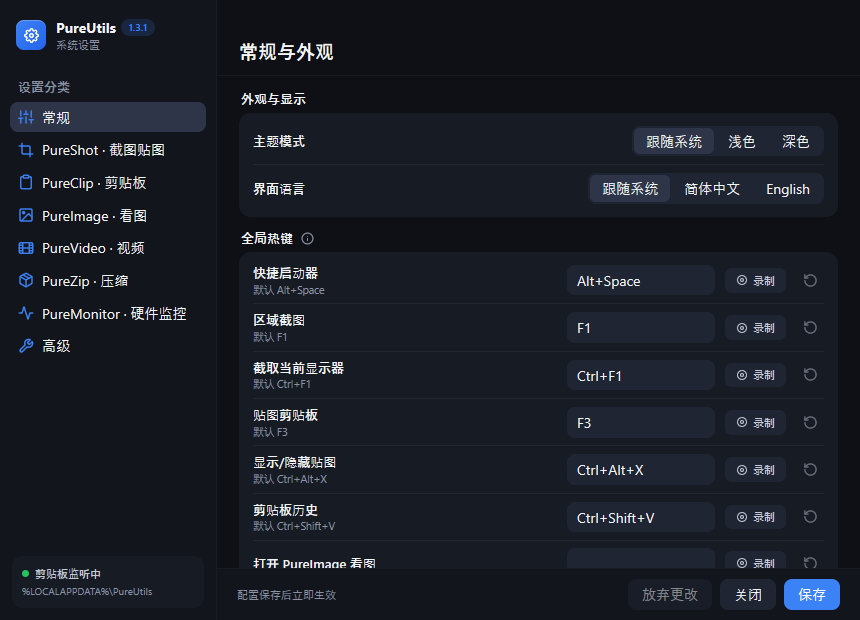
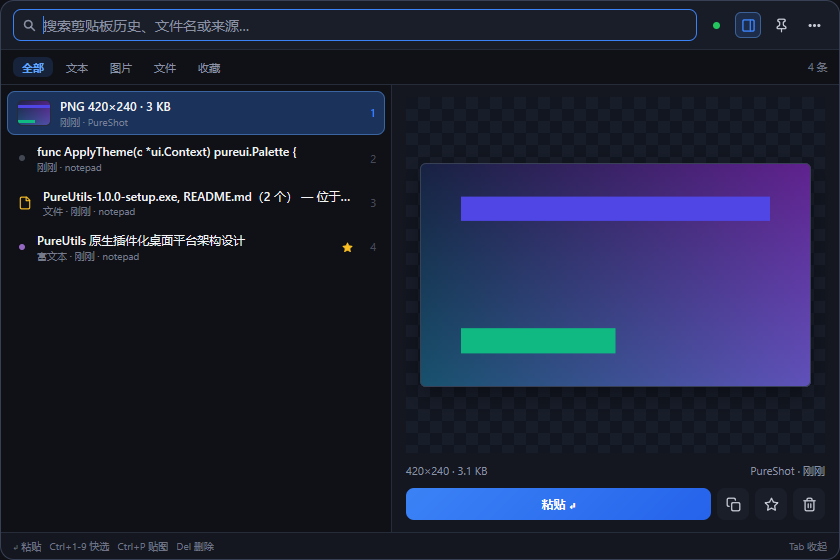
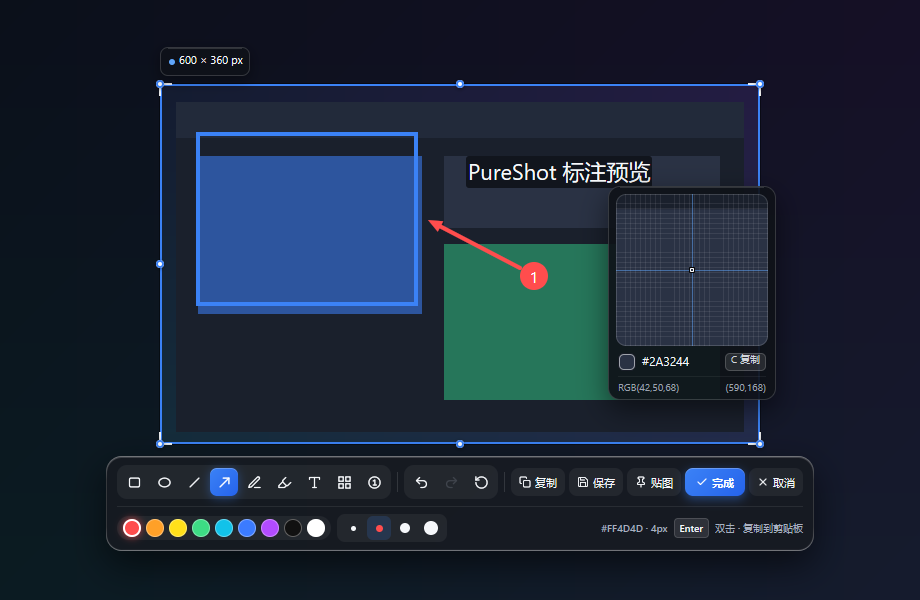
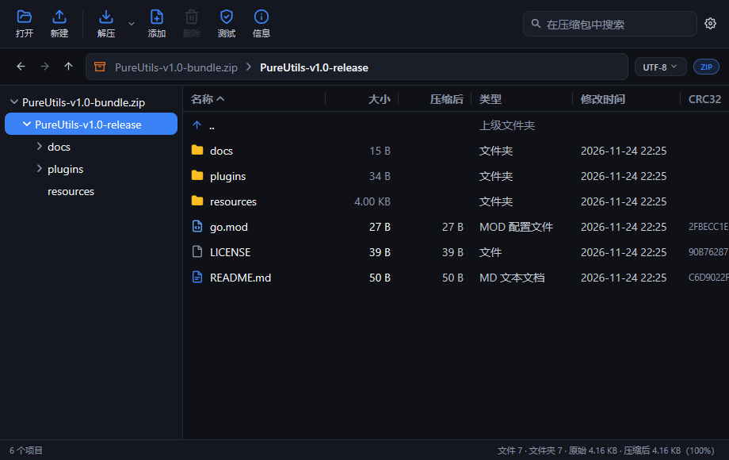
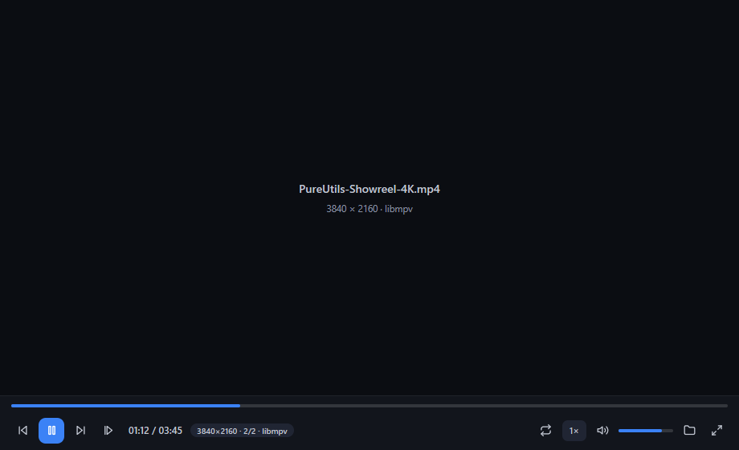

<div align="center">


# PureUtils

**Windows 原生 GPU 渲染模块化效率桌面套件**  
截图贴图 · 剪贴板历史 · 高性能看图 · 极速视频浏览 · 压缩包管理 · 全局启动器

[](LICENSE)
[](go.mod)
[](installer/pureutils.iss)
[](docs/ARCHITECTURE.md)
[](https://wangsyi.github.io/PureUtils/)

**简体中文** | [English](README.en.md) | [项目官网](https://wangsyi.github.io/PureUtils/) | [架构设计](docs/ARCHITECTURE.md) | [下载安装包](https://github.com/WangsYi/PureUtils/releases)

</div>

---

**PureUtils** 将日常高频桌面效率工具收拢在一个单可执行文件（零 WebView、零 JavaScript、零 cgo）与可复用插件底座 `pkg/purekit` 之上：由 **Go 1.27 + [MyGo](https://github.com/egoist/mygo) 原生 GPU UI** 驱动，所有组件可**编译期裁剪**、**安装期按需勾选**，并在**设置页实时热开关**。

---

## 核心特性

### 六大独立插件（零跨插件依赖）

| 插件 | 模块标识 | 核心能力 |
|---|---|---|
| **PureShot** | `capture` | 区域冻结框选、窗口智能锚点吸附、取色放大镜（按 `C` 静默复制色值）、9 种矢量标注（矩形/椭圆/直线/箭头/画笔/高亮/文字/马赛克/序号）、双击快速导出、桌面悬浮贴图 |
| **PureClip** | `history` | 隔离 SQLite（WAL）与 SHA-1 内容寻址图片存储、内存预索引毫秒级多词即时搜索、异步缩略图与大图解码缓存、分类与收藏筛选、防敏进程忽略与回放粘贴、只读兼容旧库 |
| **PureImage** | `viewer` | 支持 **40+ 图片格式**（JPG / PNG / GIF / WebP / HEIC / AVIF / JPEG XL / 24 种相机 RAW + 动图）、`libjpeg-turbo` 原生硬件级缩放、EXIF 详情面板、资源管理器**空格秒开预览**与 `P` 键贴图 |
| **PureVideo** | `video` | 内置精简裁剪版 **`libmpv` 硬件解码内核**，开箱支持 21 种视频格式（MP4 / MKV / MOV / HEVC / FLV / WebM 等）、外挂字幕、逐帧步进、倍速、循环播放与文件关联 |
| **PureZip** | `zip` | 纯 Go 多格式压缩与解压管理（读写 `ZIP / 7Z / TAR / TAR.GZ / TAR.BZ2 / TAR.XZ / TAR.ZST`，只读 `RAR v4/v5` 及单文件 `GZ/BZ2/XZ/ZST`）、树形导航、智能解压、多线程压缩、AES-256 / `-mhe`、资源管理器右键级联菜单与文件关联 |
| **PureMonitor** | `monitor` | 任务栏状态条与边缘收起迷你悬浮胶囊（支持自选指标）、硬件规格与实时传感器面板（含可选 PawnIO / 提权采集及 AMD ADL / NVML）以及零注入 ETW 游戏 FPS 悬浮层 |

### 全局快捷启动器与平台能力

- **`Alt+Space` 全局快捷启动器**：毫秒级呼出并自动捕获前景 Windows 资源管理器选中文件与当前剪贴板内容，上下文直达「智能解压 / 用 PureImage 查看 / 贴到桌面」，并支持跨插件功能与 PureClip 历史即时搜索（`Ctrl+1–9` 快捷执行）。
- **设置页实时热启停 & `Win+` 底层接管**：支持在统一设置中按模块运行时启用/停用插件并动态刷新托盘、热键、启动器与 Bus 能力代次；可选底层键盘钩子（`WH_KEYBOARD_LL`）接管 `Win+...` 组合键并抑制开始菜单弹出。
- **全套中英双语国际化（实时切换）**：支持简体中文（`zh-CN`）、英文（`en-US`）与系统语言自动识别（`Auto`），覆盖托盘菜单、启动器、设置中心与全部六大插件界面，保存后无需重启立即生效。
- **跨插件零耦合协作**：通过 `pkg/purekit` Capability Bus（`clipboard.history` / `image.preview` / `image.pin`）与来源感知剪贴板总线按需联动，任意禁用或裁剪组件均自动优雅降级。

---

## 界面预览

### 全局快捷启动器（`Alt+Space`）与设置中心
| 全局快捷启动器 | 系统设置与组件热开关 |
| :---: | :---: |
|  |  |

### 剪贴板历史（PureClip：双栏视图 & 精简浮窗）
| 双栏详情模式 | 精简快捷浮窗模式 |
| :---: | :---: |
|  |  |

### 截图与矢量标注（PureShot）、压缩管理（PureZip）与视频浏览（PureVideo）
| 截图选区与标注 | 压缩文件管理 | 极速视频浏览 |
| :---: | :---: | :---: |
|  |  |  |

---

## 下载与安装

- 从 [**GitHub Releases**](https://github.com/WangsYi/PureUtils/releases) 下载模块化安装程序 `PureUtils-1.3.0-setup.exe`（已内置裁剪版 `libmpv-2.dll`）。
- 基于 Inno Setup 的安装包采用单用户目录安装（无需管理员权限），可自由勾选 **完整套件 / PureShot+PureClip / 仅 PureImage / 仅 PureVideo / 仅 PureZip** 以及 `turbojpeg.dll` 加速、右键菜单和文件关联；卸载或取消勾选时自动清理对应注册表与快捷方式。

---

## 从源码构建

环境要求：Windows 10/11 (x64) + **Go 1.27.3+**（零 cgo、零 Node / WebView2）；如需打包安装程序需本机安装 Inno Setup 6/7（`ISCC.exe`）。

```powershell
# 编译完整版 PureUtils.exe（含全部六大插件）
.\build.ps1 build

# 编译精简版（排除 PureImage 及解码器与 turbojpeg.dll）
.\build.ps1 build -CoreOnly

# 按插件名精确编译裁剪（支持 pureshot, pureclip, pureimage, purevideo, purezip, puremonitor）
.\build.ps1 build -Exclude purezip,pureimage

# 运行全部测试（含 AST 架构/i18n 审计、无头 UI 与 UI/E2E/覆盖率门禁）
.\build.ps1 test
.\build.ps1 test -CoreOnly
.\build.ps1 ui
.\build.ps1 e2e
.\build.ps1 coverage -MinCoverage 50

# 直接运行并呼出指定模块
.\build.ps1 run -AppArgs --launcher

# 生成发行目录（artifacts\publish 与 artifacts\publish-core）或安装包
.\build.ps1 publish
.\build.ps1 pack
```

---

## 默认快捷键与命令行

| 默认快捷键 | 动作 | 命令行参数 |
|---|---|---|
| `Alt+Space` | 呼出全局快捷启动器 | `--launcher` |
| `F1` | 区域截图与标注 | `--capture` |
| `Ctrl+F1` | 截取光标所在显示器整屏 | `--capture-monitor` |
| `F3` | 将剪贴板内容贴到桌面 | `--pin` |
| `Ctrl+Alt+X` | 隐藏 / 显示所有悬浮贴图 | `--toggle-pins` |
| `Ctrl+Shift+V` | 打开剪贴板历史面板 | `--history` |
| 按需配置 | 打开 PureImage 看图 / 切换空格预览 | `--view [路径]` / `--toggle-space-preview` |
| 按需配置 | 打开 PureVideo 极速视频浏览 | `--video [路径]` |
| 按需配置 | 打开 PureZip / 压缩与解压命令 | `--zip [路径]` / `--extract-smart <文件>` |
| 按需配置 | 打开 PureMonitor 硬件与系统监控 | `--monitor` |

其他常用参数：`--settings`、`--toggle-monitoring`、`--extract-here`、`--extract-to`、`--extract-dialog`、`--compress`、`--compress-zip`、`--compress-7z`、`--test-archive`、`--background`、`--perf`、`--exit`；直接传入文件或目录路径也可自动路由打开。

---

## 数据目录与只读兼容

用户数据默认保存在 `%LOCALAPPDATA%\PureUtils`（可通过 `PUREUTILS_HOME` 环境变量覆盖）：

```text
settings.json                  v2 设置（含宿主配置与 plugins.<id> 独立分区）
plugins\pureclip\clip.db       PureClip 隔离剪贴板历史库（SQLite WAL）
plugins\pureclip\blobs\...     PureClip SHA-1 内容寻址图片缓存
plugins\pureshot\shots.db      PureShot 截图记录库
plugins\pureshot\blobs\...     PureShot 截图持久化图片
logs\                          按天滚动日志
```

> 若目录中存在旧版 `settings.json`（v1）、`pureutils.db`、`shotclip.db` 或 `images\`，各插件将以**严格只读**方式合并查询历史记录，绝不破坏或改写旧版文件。

---

## 仓库结构

```text
main.go                       MyGo 单实例入口、modules.json 读取与宿主装配
pkg/purekit/                  可复用核心插件 SDK（Plugin/Host/Bus/Contracts、config、storage、clipboard、platform、ui、core）
plugins/
  ├─ pureshot/                截图、9 种矢量标注（annotate/）与桌面贴图
  ├─ pureclip/                剪贴板监控、仓储与 Ditto 风格检索面板
  ├─ pureimage/               40+ 格式解码、EXIF、TurboJPEG、空格预览与关联
  ├─ purevideo/               内置 libmpv 硬件解码播放、交互控制与关联
  ├─ purezip/                 纯 Go 压缩引擎（archive/）、右键与关联（zipshell/）
  └─ puremonitor/             任务栏与悬浮监控、硬件传感器采集及 ETW 游戏帧率 HUD
internal/host/                薄宿主外壳（条件编译注册桥 builtin_*.go、托盘、热键、启动器、统一设置与架构测试）
installer/pureutils.iss       Inno Setup 模块化安装脚本
docs/                         宣传主页（GitHub Pages）、中英文架构文档与截图资源
```

更多分层架构、Capability Bus 契约与新增插件教程请参阅 [**ARCHITECTURE.md**](docs/ARCHITECTURE.md)（[English Version](docs/ARCHITECTURE.en.md)）。

---

## 维护策略与开源协议

- 本项目由作者个人维护，**不接受外部 Pull Request 或代码贡献**（详见 [CONTRIBUTING.md](CONTRIBUTING.md)）；欢迎通过 Issues 反馈问题，安全漏洞请参见 [SECURITY.md](SECURITY.md)。
- 行为准则见 [CODE_OF_CONDUCT.md](CODE_OF_CONDUCT.md)，第三方开源依赖与可选动态库说明详见 [THIRD_PARTY_NOTICES.md](THIRD_PARTY_NOTICES.md)。
- 本项目依据 [**GNU Affero General Public License v3.0 (AGPL-3.0)**](LICENSE) 开源发布。
